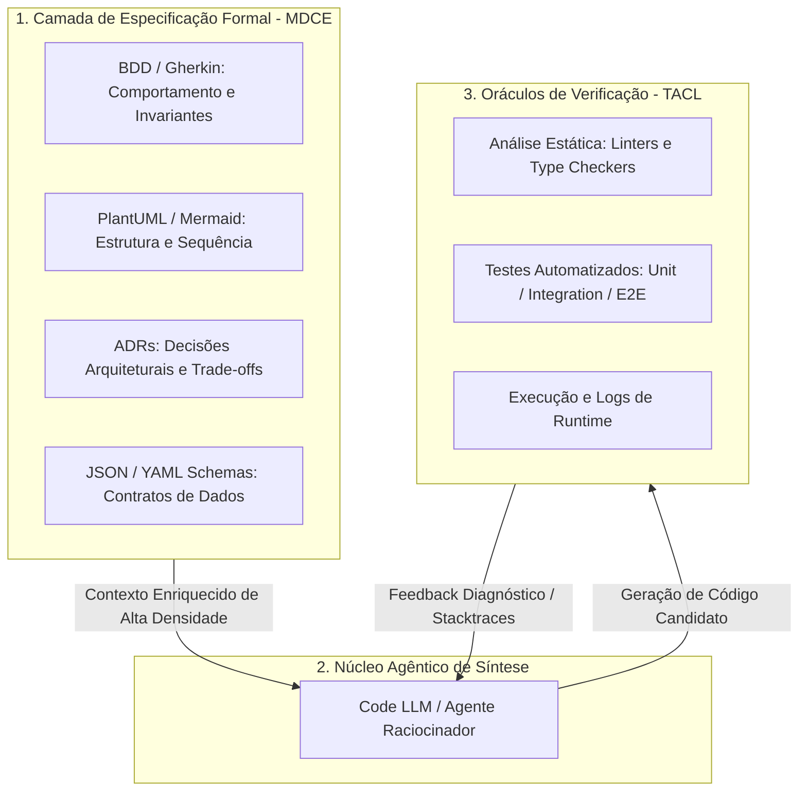

# Da Síntese Ad-hoc à Engenharia de Contexto: O Papel da Modelagem Formal e de Ciclos Fechados de Verificação em Agentes de Software Baseados em LLMs

**From Ad-hoc Synthesis to Context Engineering: The Role of Formal Modeling and Closed-Loop Verification in LLM-Based Software Agents**

---

## Resumo

A incorporação de Modelos de Linguagem de Grande Escala (LLMs) no ciclo de vida de desenvolvimento de software instaurou um novo paradigma na Engenharia de Software Orientada por Inteligência Artificial (AISE). Contudo, a abordagem predominante de interação caracterizada por prompts em linguagem natural não estruturada e ausência de oráculos de verificação externa induz a patologias críticas: saturação precoce da janela de contexto (*token burn rate*), alucinações arquiteturais e degradação de atenção (*Lost in the Middle*). Este artigo apresenta uma abordagem fundamentada em dois pilares: (i) a **Engenharia de Contexto Orientada a Modelos (MDCE)**, que emprega formalismos intermediários compactos (Gherkin/BDD, PlantUML, Mermaid e Architectural Decision Records - ADRs) como representações de alta densidade semântica; e (ii) a **Arquitetura Agêntica Aumentada por Ferramentas (TACL)**, que estabelece ciclos fechados de retroalimentação (*closed-loop verification*) utilizando analisadores estáticos, suítes de testes e motores de automação. Discute-se a transição da geração de código empírica e aberta para uma disciplina formal de especificação determinística, contrastando ecossistemas de tipagem gradual (PHP com PHPStan/Psalm) e de tipagem afim estrita (Rust com `rustc`/Clippy). Por fim, propõe-se um protocolo experimental com métricas formais (Pass@k, densidade de tokens e convergência de AST) para validação empírica.

**Palavras-chave:** Engenharia de Software Baseada em LLMs; Engenharia de Contexto; Model-Driven Engineering; Sistemas Agênticos; Verificação em Malha Fechada; Lost in the Middle.

---

## Abstract

The adoption of Large Language Models (LLMs) in the software development lifecycle has introduced a new paradigm in AI-driven Software Engineering (AISE). However, the prevalent interaction pattern—characterized by unstructured natural language prompts and the absence of external verification oracles—leads to critical pathologies: premature context window saturation (token burn rate), architectural hallucinations, and attention degradation (the *Lost in the Middle* phenomenon). This paper proposes a two-pillar framework: (i) **Model-Driven Context Engineering (MDCE)**, leveraging compact intermediate formalisms (Gherkin/BDD, PlantUML, Mermaid, and Architectural Decision Records - ADRs) as high-density semantic representations; and (ii) **Tool-Augmented Closed-Loop Verification (TACL)**, establishing autonomous feedback loops using static analyzers, automated test suites, and end-to-end engines. We discuss the transition from open-loop heuristic code generation to a disciplined, deterministic specification approach, contrasting gradual typing ecosystems (PHP with PHPStan/Psalm) and affine strict type systems (Rust with `rustc`/Clippy). Finally, an empirical evaluation protocol comprising formal metrics (Pass@k, token density, AST convergence) is delineated.

**Keywords:** LLM-based Software Engineering; Context Engineering; Model-Driven Engineering; Agentic Systems; Closed-Loop Verification; Lost in the Middle.

---

## 1. Introdução

A emergência de modelos fundacionais de fronteira com capacidades generativas de código (Code LLMs) tem provocado uma reavaliação dos processos tradicionais de síntese de programas. No entanto, a literatura recente e a prática industrial revelam um contraste marcante entre duas abordagens diametralmente opostas:

1. **A Abordagem Ad-hoc (Ingênua):** Caracterizada pela transmissão de instruções prolixas em linguagem natural e despejo indiscriminado de fragmentos de código-fonte na janela de contexto. O modelo atua como um sistema preditivo em malha aberta (*open-loop*), desprovido de restrições formais e de mecanismos de introspecção executável.
2. **A Abordagem Orientada a Engenharia (Sistemática):** Fundamentada na formulação prévia de artefatos de especificação arquitetural, contratos formais de interface e ambientes dotados de instrumentação diagnóstica (analisadores estáticos, linters e testes unitários), permitindo ao modelo atuar como agente em malha fechada (*closed-loop*).

A abordagem ad-hoc colapsa sob sistemas de média e alta complexidade devido a restrições intrínsecas à arquitetura dos transformadores (*Transformers*). Dentre estas, destacam-se a dispersão de atenção em contextos extensos formalizada empiricamente por Liu et al. (2024) como o fenômeno *Lost in the Middle* e o custo computacional e financeiro quadrático/linear associado à taxa de queima de tokens (*token burn rate*).

Diante dessa problemática, este artigo investiga as seguintes **Questões de Pesquisa (Research Questions)**:

* **RQ1:** *Em que medida a substituição de linguagem natural por linguagens de modelagem e especificação técnica (BDD, PlantUML, ADRs) otimiza o uso da janela de contexto e atenua taxas de alucinação sintática e semântica?*
* **RQ2:** *Como a integração de ferramentas de análise estática e dinâmica em um ciclo agêntico de retroalimentação (*Tool-Augmented Loop*) viabiliza a autocorreção autônoma de código em comparação à geração unidirecional?*

O objetivo central deste trabalho é formalizar um framework que une os preceitos clássicos da **Engenharia de Software Orientada a Modelos (MDSE)** às recentes técnicas de **Engenharia de Contexto e Sistemas Agênticos**, demonstrando que a eficácia da IA generativa em software é uma função direta do rigor da especificação e da autonomia de validação do ambiente.

---

## 2. Fundamentação Teórica e Trabalhos Relacionados

### 2.1 Model-Driven Software Engineering (MDSE) e Design by Contract (DbC)

A Engenharia de Software Orientada a Modelos (MDSE) estabelece que modelos conceituais abstratos devem ser os artefatos primários do desenvolvimento, atuando como fontes formais de verdade a partir das quais implementações são derivadas (Schmidt, 2006). Complementarmente, o conceito de *Design by Contract* (Meyer, 1992) estipula que componentes de software devem operar sob pré-condições, pós-condições e invariantes estritamente delimitados.

Quando transpostos para a interação com LLMs, esses princípios resolvem a ambiguidade intrínseca da linguagem natural. Em vez de prompts puramente imperativos ("*crie uma função para autenticar usuários*"), a especificação de contratos em linguagens como **Gherkin** (*Given-When-Then*) e diagramas relacionais formais estabelece limites claros para o espaço de busca estocástico do modelo.

### 2.2 Dinâmica de Atenção em LLMs e o Fenômeno *Lost in the Middle*

A arquitetura dos transformadores utiliza mecanismos de autoatenção (*self-attention*) cujo custo computacional e distribuição de relevância variam ao longo da sequência. Pesquisas empíricas conduzidas por Liu et al. (2024) demonstram que modelos de linguagem apresentam assimetria de recuperação: o desempenho na extração e correlação de informações é significativamente superior nas extremidades do contexto (início e fim da sequência), degradando vertiginosamente quando informações cruciais residem no terço intermediário do prompt.

```
Capacidade de
Recuperação / Precisão
  ▲
1.0│  ████                                      ████
   │  ████                                      ████
   │  ████                                      ████
0.5│  ████   ░░░░░░░░░░░░░░░░░░░░░░░░░░░░░░░░   ████
   │  ████   ░░░░ Lost in the Middle ░░░░░░░░   ████
0.0└──┴──────┴──────────────────────────────────┴──────►
     Início          Centro do Contexto          Fim
```

Ao sobrecarregar a janela com código legado não sanitizado ou narrativas redundantes, o usuário induz uma **diluição da densidade semântica**, elevando o ruído informacional (baixo *Signal-to-Noise Ratio* - SNR) e provocando alucinações arquiteturais e omissão de requisitos não funcionais.

### 2.3 Sistemas Agênticos, Paradigma ReAct e Reflexion

A transição de geradores passivos de texto para **Agentes Autônomos de Software** apoia-se no paradigma **ReAct** (*Reasoning and Acting*) (Yao et al., 2023), no qual o modelo alterna dinamicamente entre traços de raciocínio lógico e emissão de comandos para um ambiente de execução.

Expandindo esse conceito, o framework **Reflexion** (Shinn et al., 2023) introduz memória episódica verbal baseada em feedback de execução: erros emitidos por compiladores ou asserções de teste são convertidos em reflexões linguísticas, orientando rodadas subsequentes de refatoração sem intervenção humana direta.

---

## 3. O Framework MDCE: Engenharia de Contexto Orientada a Modelos

A metodologia proposta estrutura a comunicação com o LLM em uma hierarquia de artefatos formais com alta razão sinal/ruído:



### 3.1 Artefatos Estruturados como Representações Intermediárias (IR)

1. **Definição de Comportamento via BDD (Gherkin):** Converte requisitos funcionais ambíguos em autômatos de estado verificáveis (*Given*, *When*, *Then*), viabilizando a síntese imediata de testes automatizados e código de produção correspondente.
2. **Modelagem Estrutural e Comportamental (PlantUML / Mermaid):** Representações textuais de diagramas de classes, entidades-relacionamento (EER) e diagramas de sequência possuem densidade informacional superior à prosa humana. Poucas linhas de DSL representam cardinalidades, hierarquias de herança e fluxos temporais assíncronos de forma unívoca.
3. **Registros de Decisão Arquitetural (ADRs):** Documentam restrições globais (e.g., "*uso de banco de dados relacional com isolamento SERIALIZABLE*", "*adoção de arquitetura hexagonal com inversão de dependência*"), eliminando a exploração de padrões incompatíveis pelo modelo.
4. **Esquemas Contratuais (JSON Schema / Protocol Buffers):** Eliminam incertezas na manipulação de dados transitórios e interfaces de comunicação externa.

---

## 4. Ambientes de Execução Aumentados: Fechando a Malha de Controle (TACL)

A geração puramente preditiva constitui um sistema de **malha aberta (open-loop)**: a entrada gera uma saída sem validação de conformidade. Ao dotar o agente de ferramentas externas de diagnóstico, o sistema converte-se em uma **malha fechada (closed-loop)**:

$$\text{Código Candidato} \xrightarrow{\text{Execução}} \text{Oráculo Externo} \xrightarrow{\text{Diagnóstico}} \text{Autocorreção (Reflexion)}$$

### 4.1 O Ecossistema de Tipagem Gradual e Dinâmica: Estudo de Caso PHP

Em linguagens de tipagem dinâmica ou gradual como PHP, o agente que opera sem ferramentas corre sério risco de gerar violações silenciosas de tipo em tempo de execução. O ambiente instrumentado fornece ao agente uma suíte integrada de oráculos:

* **Análise Estática Rigorosa:** `PHPStan` (em nível 9 ou `max`) e `Psalm` atuam como verificadores de tipagem e nulabilidade antes da execução.
* **Testes de Unidade e Comportamento:** `Pest PHP` e `PHPUnit` validam contratos e limites lógicos. `Behat + Mink` validam os cenários Gherkin em nível de aceitação.
* **Validação de Interface e E2E:** `Playwright` valida o comportamento integrado no navegador, capturando erros de console e quebras de fluxo.

Quando o agente gera uma atribuição incompatível, o output do `PHPStan` serve como prompt de retificação estritamente direcionado, evitando a reescrita desnecessária de blocos funcionais do código.

### 4.2 O Ecossistema de Tipagem Estrita e Propriedade: Estudo de Caso Rust

No ecossistema Rust, a presença do compilador (`rustc`) com seu sistema de tipos afins e verificador de empréstimos (*borrow checker*) atua como o oráculo determinístico definitivo para o LLM.

* O compilador emite diagnósticos estruturados em formato JSON (`cargo check --message-format=json`).
* Esses relatórios detalham código de erro, span exato de linha e coluna, além de sugestões de resolução emitidas pelo próprio compilador.
* Aliado ao `cargo clippy` (verificação idiomática de performance e correção), o ciclo de feedback atinge convergência em poucas iterações sem supervisão humana.

---

## 5. Análise Comparativa Multidimensional

A Tabela 1 sintetiza as discrepâncias estruturais, computacionais e qualitativas entre a abordagem ad-hoc e a abordagem disciplinada proposta.

**Tabela 1:** Comparativo entre a Síntese Ad-hoc e a Engenharia de Contexto com Verificação em Malha Fechada.

| Dimensão de Análise | Abordagem Ad-hoc (Linguagem Natural Desestruturada) | Abordagem Proposta: MDCE + TACL (Especificação Formal + Malha Fechada) | Impacto Técnico e Científico |
| :--- | :--- | :--- | :--- |
| **Ambiguidade Semântica** | Alta (prosa polissêmica e interpretativa) | Nula ou Mínima (DSLs formais, esquemas e contratos) | Elimina desvios de intenção e alucinações de escopo. |
| **Densidade de Informação (SNR)** | Baixa (predomínio de conectivos, ruído e repetições) | Máxima (representações simbólicas de alta densidade) | Mitiga o efeito *Lost in the Middle* (Liu et al., 2024). |
| **Taxa de Queima de Tokens (*Burn Rate*)** | Exponencial / Desperdiçadora (retransmissões integrais) | Estritamente Otimizada (apenas deltas e especificações) | Redução drástica de custos computacionais e latência. |
| **Topologia do Sistema** | Malha Aberta (*Open-loop*, geração passiva) | Malha Fechada (*Closed-loop*, guiada por oráculos) | Capacidade autônoma de convergência e autocorreção. |
| **Oráculos de Validação** | Inspecção manual humana pós-fato | Linters, Compiladores, Test Suites e E2E Engines | Diagnóstico em tempo de máquina com reprodutibilidade. |
| **Débito Técnico Residual** | Elevado (código não conforme, regressões ocultas) | Controlado (conformidade com ADRs e regras estáticas) | Sustentabilidade de longo prazo no ciclo de vida de software. |

---

## 6. Proposta Metodológica para Validação Empírica

Para pesquisadores interessados em mensurar quantitativamente a superioridade da abordagem aqui postulada, define-se um desenho experimental rigoroso composto pelas seguintes métricas:

### 6.1 Métricas de Desempenho e Eficiência

1. **Pass@k (Taxa de Sucesso Funcional):** Proporção de problemas resolvidos com sucesso onde pelo menos uma em $k$ soluções geradas passa em 100% dos casos de teste de aceitação (Chen et al., 2021).
2. **Razão de Consumo de Tokens por Ponto de Função ($R_{TF}$):**
   $$R_{TF} = \frac{\text{Total de Tokens Consumidos (Prompt + Completion)}}{\text{Pontos de Função ou Linhas Lógicas de Código (LLOC) Produzidos}}$$
3. **Distância na Árvore Sintática Abstrata (AST Edit Distance):** Medida de divergência entre a estrutura de classes planejada na modelagem (PlantUML) e a AST gerada na implementação final.
4. **Ciclos de Convergência de Erro ($C_{CE}$):** Quantidade de iterações necessárias entre o agente e o oráculo estático até a eliminação completa de alertas de linter e compilação.

---

## 7. Discussão, Ameaças à Validade e Trabalhos Futuros

### 7.1 Limitações da Abordagem
* **Custo Cognitivo Inicial:** A elaboração de artefatos MDCE demanda engenheiros de software seniores com sólido domínio em arquitetura, diagramação técnica e formalismos de modelagem.
* **Context Budget dos Oráculos:** Mensagens de erro de analisadores ou tracebacks excessivamente extensos podem, se não sumarizados previamente, reintroduzir o problema de saturação de contexto que a metodologia visa evitar.

### 7.2 Trabalhos Futuros
Pesquisas subsequentes devem focar no desenvolvimento de **compiladores semânticos de contexto**, capazes de transformar especificações UML em representações intermediárias pré-otimizadas com compressão semântica para LLMs, bem como na criação de adaptadores de feedback inteligentes que filtram o ruído de logs de teste antes da reinjeção na janela de contexto.

---

## 8. Considerações Finais

A substituição de interações ad-hoc por uma metodologia orientada a especificações formais (MDCE) combinada a agentes instrumentados com oráculos executáveis (TACL) representa o amadurecimento científico da Engenharia de Software no contexto de modelos generativos. 

Conclui-se que o limitante do desempenho dos LLMs não repousa primariamente na capacidade inerente dos pesos do modelo, mas na arquitetura de informação e nos mecanismos de validação fornecidos pelo engenheiro. Ao tratar a modelagem como representação intermediária e o ecossistema de ferramentas como malha fechada de feedback, transforma-se o LLM de um autômato estocástico vulnerável em um compilador de alta abstração, rigoroso e auditável.

---

## Referências Bibliográficas

* CHEN, M. et al. Evaluating Large Language Models Trained on Code. **arXiv preprint arXiv:2107.03374**, 2021.
* FOWLER, M. **UML Distilled: A Brief Guide to the Standard Object Modeling Language**. 3. ed. Boston: Addison-Wesley Professional, 2003.
* JIMENEZ, C. E. et al. SWE-bench: Can Language Models Resolve Real-World GitHub Issues? In: **International Conference on Learning Representations (ICLR)**, 2024.
* LIU, N. F. et al. Lost in the Middle: How Language Models Use Long Contexts. **Transactions of the Association for Computational Linguistics (TACL)**, v. 12, p. 157–173, 2024.
* MEYER, B. Applying "Design by Contract". **Computer**, IEEE, v. 25, n. 10, p. 40–51, 1992.
* NYGARD, M. Documenting Architecture Decisions. In: **Cognitect Blog**, 2011. Disponível em: <http://thinkrelevance.com/blog/2011/11/15/documenting-architecture-decisions>. Acesso em: 2026.
* SCHMIDT, D. C. Model-Driven Engineering. **Computer**, IEEE, v. 39, n. 2, p. 25–31, 2006.
* SHINN, N. et al. Reflexion: Language Agents with Verbal Reinforcement Learning. In: **Thirty-seventh Conference on Neural Information Processing Systems (NeurIPS)**, 2023.
* VASWANI, A. et al. Attention Is All You Need. In: **Advances in Neural Information Processing Systems (NeurIPS)**, p. 5998–6008, 2017.
* YAO, S. et al. ReAct: Synergizing Reasoning and Acting in Language Models. In: **International Conference on Learning Representations (ICLR)**, 2023.
