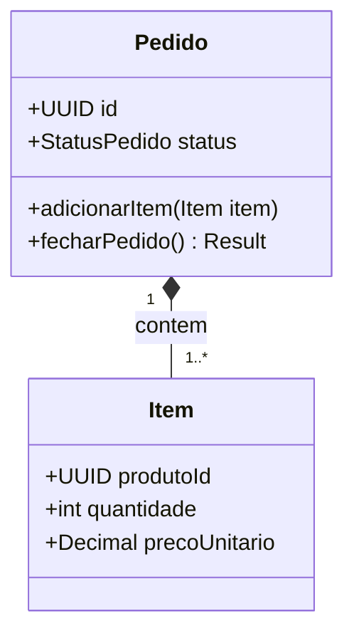

# Por que a Maioria dos Desenvolvedores Usa IA de Forma Amadora (e Como Engenheiros Seniores Constroem Sistemas Robustos com 10x Menos Tokens)

Você já deve ter visto esse cenário se repetir dezenas de vezes nas redes sociais e nas comunidades de tecnologia:

Um desenvolvedor abre o ChatGPT, Claude ou Gemini, cola centenas de linhas de código legado ou um prompt descritivo de três parágrafos genéricos e pede: *"Crie um módulo completo de faturamento para o meu sistema"*.

O modelo gera um código com pequenos erros de sintaxe, tipos inconsistentes ou alucinações de regras de negócio. O desenvolvedor tenta consertar enviando mais mensagens, o limite de tokens estoura em meia hora e a conclusão imediata que ele publica no LinkedIn é:  
> *"IA só serve para gerar código boilerplate e não substitui programador de verdade."*

Enquanto isso, em equipes de alta maturidade, engenheiros seniores estão utilizando esses exatos mesmos modelos para estruturar microsserviços inteiros, refatorar domínios complexos e gerar suítes completas de testes funcionais em poucas horas gastando uma fração dos tokens e com taxa de retrabalho próxima de zero.

Qual é o segredo? **A diferença não está na inteligência do modelo de IA. A diferença está em como você alimenta e valida esse modelo.**

Neste artigo, vamos dissecar por que o paradigma do *"prompt em linguagem natural"* está morto para softwares de produção e como a combinação de **Modelagem Formal (MDCE)** e **Agentes em Malha Fechada (Closed-Loop)** muda completamente o jogo da Engenharia de Software.

---

## 1. O Problema Fundamental: A Ilusão do "Oráculo Mágico"

Muitos profissionais tratam a IA generativa como um oráculo mágico onisciente. Na prática da Ciência da Computação, um Large Language Model (LLM) é um **motor preditivo estocástico baseado em mecanismos de atenção (Transformers)**.

Quando você interage com ele apenas usando prosa descritiva em português ou inglês, você comete dois erros técnicos graves:

### A. A Falácia da Ambiguidade da Linguagem Natural
A linguagem humana é inerentemente polissêmica e ambígua. Uma frase simples como *"o usuário só pode comprar se estiver ativo e com saldo positivo ou limite aprovado"* abre margem para múltiplas árvores de precedência lógica se você não usar parênteses matemáticos ou tabelas-verdade formais. A IA precisa *adivinhar* a sua intenção, e adivinhação em probabilidade resulta em alucinação.

### B. O Fenômeno Científico do *Lost in the Middle* (Liu et al., 2024)
Pesquisadores da Stanford e Berkeley comprovaram que a atenção dos transformadores não é homogênea. Quando você sobrecarrega a janela de contexto com blocos massivos de código, documentações dispersas e instruções prolixas, o modelo:
1. Lembra muito bem do início do prompt.
2. Lembra bem do final do prompt.
3. **Degrada dramaticamente a atenção no terço central.**

Se a regra de ouro do seu domínio estiver no meio daquele bloco de texto confuso, o modelo vai ignorá-la ou alucinar. Você gasta milhares de tokens (queima de contexto) para receber um código defeituoso.

```
Atenção do Modelo
  ▲
1.0│  ████ (Início: Instruções Iniciais)        ████ (Fim: Última Pergunta)
   │  ████                                      ████
0.5│  ████   ░░░░░░░░░░░░░░░░░░░░░░░░░░░░░░░░   ████
   │  ████   ░░░░ Regras Críticas Perdidas ░░   ████
0.0└──┴──────┴──────────────────────────────────┴──────►
              Centro do Contexto (Ruído)
```

---

## 2. Pilar 1: Modelagem como Linguagem de Entrada (MDCE)

Nenhum arquiteto civil pede aos pedreiros: *"Construa uma casa moderna de três andares com salas bem arejadas"*. Ele entrega uma **planta-baixa**, com cotas milimétricas, diagramas elétricos e cálculos estruturais.

Na Engenharia de Software auxiliada por IA, **a modelagem técnica é a planta-baixa**. Em vez de tentar descrever sistemas com prosa, o engenheiro qualificado utiliza linguagens formais de alta densidade semântica:

### 1. Definição de Comportamento e Invariantes: BDD (Gherkin)
Em vez de dizer: *"Quero que valide o estoque antes da compra"*, você entrega:

```gherkin
Cenário: Tentativa de compra de item sem estoque disponível
  Dado que o cliente autenticado possui limite de crédito de R$ 500,00
  E o produto "Notebook Alpha" possui saldo em estoque igual a 0 unidades
  Quando o cliente requisitar o fechamento do pedido para 1 unidade
  Então o sistema deve rejeitar a transação com o erro "ESTOQUE_INSUFICIENTE"
  E nenhuma reserva financeira deve ser efetuada no gateway de pagamento
```
O modelo não precisa deduzir nada. Cada linha mapeia diretamente para um teste unitário e para uma condicional atômica no domínio.

### 2. Modelagem Estrutural: PlantUML e Mermaid
Um diagrama textual em PlantUML ou Mermaid possui **altíssima razão sinal-ruído (Signal-to-Noise Ratio)**. Em menos de 20 linhas de texto, você declara entidades, chaves, cardinalidades e relações sem gastar tokens com adjetivos e pontuações irrelevantes:


Ao ler essa representação, a IA compreende a estrutura em nível de Árvore Sintática Abstrata (AST) com fidelidade quase matemática.

### 3. Registro de Decisões Arquiteturais: ADRs (Architectural Decision Records)
Diga adeus a prompts gigantes repetindo as mesmas regras. Um ADR de uma página define o espaço de busca do modelo:
* *"ADR-004: Adotaremos Arquitetura Hexagonal. O domínio jamais conhecerá o banco de dados. Qualquer persistência deve ocorrer através de Portas (Interfaces) implementadas em Adaptadores de Infraestrutura."*

Pronto. O modelo está delimitado e não vai inventar de acoplar o Eloquent ou o Diesel direto nas suas entidades de negócio.

---

## 3. Pilar 2: Nunca Deixe a IA Trabalhar "Às Cegas" (Closed-Loop Feedback)

Aqui está a maior virada de chave da Engenharia de Software atual: **o prompt cego vs. o agente instrumentado.**

### A Síntese Cega (Malha Aberta / Open-Loop)
O amador recebe o código gerado pela IA, copia manualmente para a IDE, roda, vê que quebrou, volta no chat, cola o erro e pergunta: *"Deu esse erro, o que eu faço?"*.  
Isso é geração em malha aberta: não há verificação automatizada nem validação em tempo de execução.

### A Síntese Instrumentada (Malha Fechada / Closed-Loop)
O engenheiro moderno cria um ambiente onde o agente de IA possui **oráculos de verificação executáveis** (ferramentas). O agente gera o código, executa a verificação, lê o resultado da máquina e se autocorrige antes de te entregar o artefato final.

```
[ Especificação MDCE ] ──► [ Agente LLM ] ──► [ Gera Código Candidato ]
                                 ▲                          │
                                 │                          ▼
                    [ Diagnóstico Estruturado ] ◄── [ Oráculo / Ferramenta ]
                       (Compilador / Linter / Testes)
```

Vejamos como isso funciona na prática em dois ecossistemas muito diferentes:

### No Ecossistema PHP Moderno:
Em linguagens de tipagem dinâmica ou gradual, o agente deixado solto pode facilmente introduzir tipos nulos indesejados ou quebras de contrato. Por isso, fornecemos ao agente:
* **PHPStan (nível 9 / max) ou Psalm:** Se o agente cometer um deslize de tipagem, o linter estático aponta a linha e o motivo exato.
* **Pest PHP / PHPUnit:** O agente roda a suíte de testes. Se um caso de borda falhar, ele lê o traceback e refatora o algoritmo autonomamente.
* **Behat + Mink:** Garante que os cenários Gherkin foram atendidos de ponta a ponta.
* **Playwright:** Valida fluxos reais de interface e captura erros de console do navegador.

### No Ecossistema Rust:
Rust é o exemplo supremo do casamento entre IA e compiladores. O `rustc` não é apenas um compilador; ele é um **provador formal de teoremas**:
* O *Borrow Checker* e os sistemas de tipos afins impedem *data races*, referências nulas e ponteiros soltos.
* Ao configurar o agente para rodar `cargo check --message-format=json`, o compilador devolve diagnósticos extremamente precisos em JSON, com o número exato do erro (ex: `E0382`), o span de linha e coluna, e até a sugestão exata de resolução (`consider borrowing here: &x`).
* Com `cargo clippy` e `cargo test`, o ciclo de feedback fecha em poucas iterações sem a necessidade de um humano ditar o óbvio.

---

## 4. O Impacto Real: Comparativo Técnico

| Métrica de Engenharia | Abordagem Amadora (Prompt Desestruturado) | Abordagem Sênior (MDCE + Feedback em Malha Fechada) |
| :--- | :--- | :--- |
| **Formato de Entrada** | Parágrafos de texto livre e despejo de arquivos | BDD (Gherkin), diagramas PlantUML/Mermaid e ADRs |
| **Densidade de Contexto** | Baixa (muito ruído, conectivos, explicações vagas) | Máxima (apenas invariantes, contratos e tipagens) |
| **Consumo de Tokens** | Explosivo (re-prompts contínuos por frustração) | Cirúrgico (apenas especificações e deltas de código) |
| **Detecção de Erros** | Manual (o dev vira o compilador do chat) | Automatizada (oráculos: linters, testes, compilador) |
| **Risco de Alucinação** | Altíssimo (*Lost in the Middle* ativo) | Praticamente Nulo (regras formalmente delimitadas) |
| **Débito Técnico Residual**| Imenso (código frágil que ninguém audita) | Mínimo (aderente às diretrizes de arquitetura) |

---

## 5. Como Começar a Aplicar Essa Metodologia Hoje

Se você deseja elevar a maturidade do seu fluxo com IA a partir de amanhã, adote este checklist simples antes de abrir qualquer ferramenta de IA:

1. **Defina a Regra antes do Código:** Escreva 3 ou 4 cenários em Gherkin cobrindo o caminho feliz e as exceções da feature.
2. **Desenhe a Relação:** Se envolver banco de dados ou múltiplos serviços, faça um diagrama rápido de sequência ou classes em Mermaid/PlantUML.
3. **Delimite o Escopo via ADR:** Informe explicitamente ao modelo as restrições: *"Use o framework X na versão Y, aplique o padrão Repository, não use dependências externas para criptografia"*.
4. **Instrumente o Ambiente:** Permita que o seu assistente ou agente execute linters rigorosos (`cargo check`, `phpstan`, `tsc`, `eslint`, `pytest`) e rode testes automatizados.
5. **Deixe o Ciclo Convergir:** Deixe a IA interpretar a saída da máquina e refatorar o código até que todos os testes passem.

---

## Conclusão: O Papel do Desenvolvedor Não Acabou. Ele Foi Elevado.

A inteligência artificial não torna obsoletos os conceitos clássicos da Engenharia de Software. **Pelo contrário: ela os torna mais indispensáveis do que nunca.**

Quem dependia apenas de decorar sintaxe de linguagens e escrever códigos operacionais repetitivos sem entender arquitetura está, sim, em apuros. Mas quem domina **modelagem de software, design de sistemas, formalização de requisitos e arquiteturas de teste** agora tem em mãos um multiplicador de força de magnitude incomparável.

A IA não é o arquiteto do seu sistema. Ela é a melhor e mais rápida equipe de construtores que você já teve contanto que você saiba desenhar a planta-baixa.

---

### E na sua equipe?
* Como vocês têm estruturado o contexto ao usar IAs para codificação no dia a dia?
* Já utilizam linters e testes integrados no loop do assistente de código?

Vamos trocar ideias e experiências nos comentários! 💬👇

#EngenhariaDeSoftware #InteligenciaArtificial #DesenvolvimentoDeSoftware #CleanCode #ArquiteturaDeSoftware #RustLang #PHP #PromptEngineering #ContextEngineering #SoftwareEngineering
