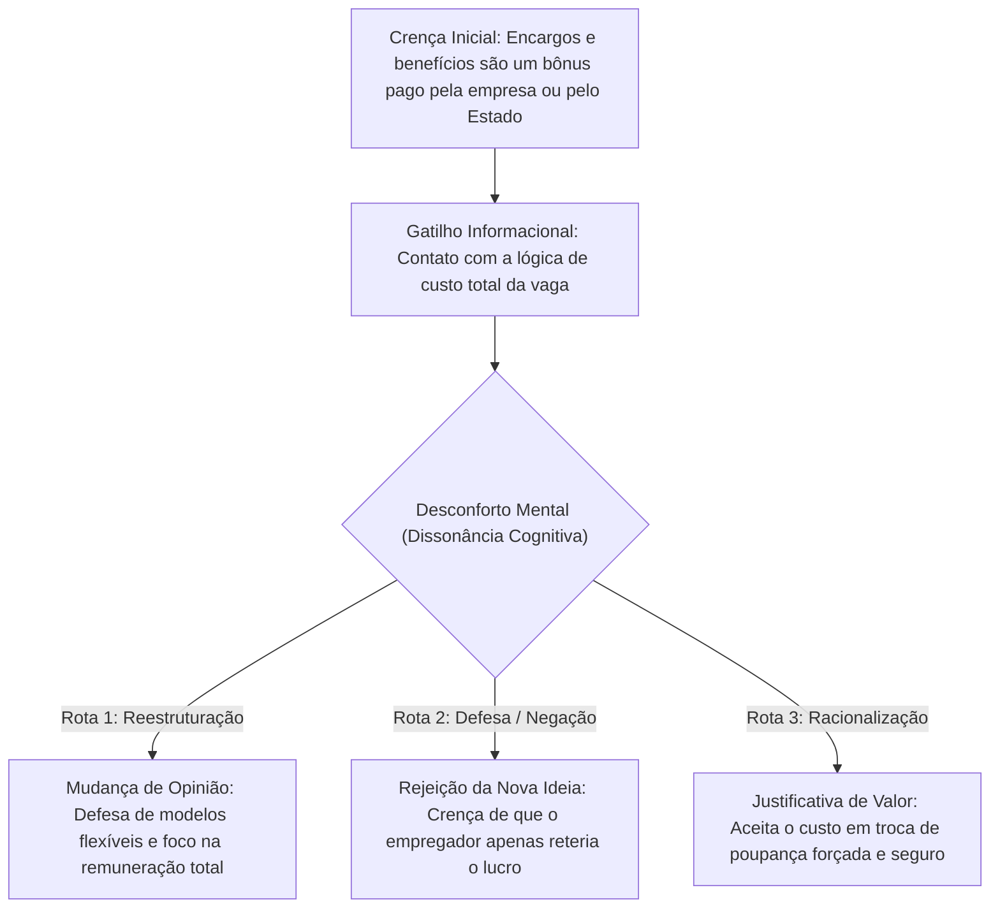

# Dissonância Cognitiva, "Direitos" Trabalhistas e o Choque de Realidade do Empreendedor: Uma Análise Psicológica e Econômica

> *"O desconforto mental surge quando duas cognições psicologicamente opostas passam a coexistir, e frequentemente só se dissolve quando a realidade prática impede que continuemos sustentando a ilusão."*

**Área temática:** Psicologia Social, Economia Comportamental, Economia do Trabalho e Finanças Públicas  
**Objeto de estudo:** A percepção assimétrica sobre encargos e "direitos" trabalhistas entre assalariados e empreendedores de primeira viagem

---

## Sumário

1. [Introdução: O Paradoxo Perceptivo do "Bolso do Trabalhador"](#1-introdução-o-paradoxo-perceptivo-do-bolso-do-trabalhador)
2. [Arquitetura Psicológica da Dissonância Cognitiva](#2-arquitetura-psicológica-da-dissonância-cognitiva)
3. [Os Três Caminhos de Resolução no Trabalhador](#3-os-três-caminhos-de-resolução-no-trabalhador)
4. [A Base Econômica do Conflito: Incidência Tributária e Benefícios Mandatórios](#4-a-base-econômica-do-conflito-incidência-tributária-e-benefícios-mandatórios)
5. [O Choque de Realidade do Primeiro Empreendedor e a "Matemática Inversa"](#5-o-choque-de-realidade-do-primeiro-empreendedor-e-a-matemática-inversa)
6. [Implicações para o Debate Público e a Literacia Econômica](#6-implicações-para-o-debate-público-e-a-literacia-econômica)
7. [Referências Bibliográficas](#7-referências-bibliográficas)

---

## 1. Introdução: O Paradoxo Perceptivo do "Bolso do Trabalhador"

Poucos temas econômicos despertam reações emocionais tão intensas quanto a constatação de que benefícios compulsórios e encargos incidentes sobre a folha de pagamento não representam um acréscimo gratuito custeado pelo empregador, mas uma parcela do valor econômico produzido pelo próprio trabalho que deixa de compor o salário líquido imediato.

Do ponto de vista estritamente psicológico, a resistência a essa ideia ilustra com precisão o conceito de **dissonância cognitiva**, formulado originalmente por **Leon Festinger** (1957). O fenômeno ocorre quando um indivíduo sustenta simultaneamente duas cognições (crenças, valores ou informações) inconsistentes entre si:

1. **Cognição inicial (crença herdada):** *"Os encargos e benefícios trabalhistas, como FGTS, 13º salário, férias remuneradas e contribuição patronal, são conquistas sociais pagas exclusivamente pelo empregador ou garantidas pelo Estado como um bônus acima do meu salário."*
2. **Cognição conflitante (evidência econômica):** *"O empregador calcula o custo total da contratação dentro de um orçamento limitado; logo, quanto maior a fatia absorvida por tributos e provisões obrigatórias, menor a margem disponível para o salário líquido."*

O choque entre a ideia reconfortante (*"tenho direitos que me protegem sem custo para mim"*) e a restrição material (*"esses direitos reduzem o dinheiro que cai diretamente na minha conta"*) produz uma tensão psicológica desconfortável. O objetivo deste estudo é examinar **como a mente humana administra essa tensão** enquanto o indivíduo atua como trabalhador assalariado, **quais são os fundamentos e os limites empíricos dessa tese na economia do trabalho**, e **por que a dissonância costuma se dissolver apenas quando o indivíduo atravessa a fronteira para o papel de empreendedor**.

---

## 2. Arquitetura Psicológica da Dissonância Cognitiva

A permanência de visões divergentes sobre a origem dos encargos trabalhistas não decorre de mera falta de informação técnica. Ela é sustentada por mecanismos cognitivos e institucionais que atuam de forma coordenada.

### 2.1. A Teoria Clássica de Festinger (1957) e a Motivação pela Consistência

Em *A Theory of Cognitive Dissonance* (1957), **Leon Festinger** demonstrou que a inconsistência entre cognições gera um estado motivacional aversivo comparável à fome ou à sede: o organismo busca reduzir o desconforto restaurando a coerência interna. A magnitude da dissonância é proporcional a dois fatores:

- **A importância subjetiva das cognições envolvidas:** o salário, a sensação de justiça no trabalho e o senso de proteção social ocupam lugar central na identidade e na segurança material do trabalhador;
- **A proporção de cognições dissonantes frente às consonantes:** quanto mais evidências contradizem uma crença central, maior a pressão para reestruturar a visão de mundo ou construir justificativas protetoras.

No experimento clássico de **Festinger e Carlsmith** (1959), participantes que executaram tarefas tediosas e receberam uma recompensa mínima (US$ 1) para afirmar que a tarefa fora agradável passaram a acreditar genuinamente nisso, ao passo que aqueles que receberam uma recompensa alta (US$ 20) não mudaram de opinião, pois tinham justificativa externa suficiente. O paralelo institucional é revelador: quando um sistema exige aceitação cotidiana sem transparência de custos, o indivíduo tende a ajustar suas crenças internas para enxergar valor positivo no arranjo vigente.

### 2.2. Contabilidade Mental (*Mental Accounting*) e Efeito de Enquadramento (*Framing*)

A dissonância é amplificada pelo modo como o contracheque e a legislação fragmentam os fluxos financeiros. Segundo **Richard Thaler** (1999), em *Mental Accounting Matters*, a mente humana viola o princípio econômico da **fungibilidade do dinheiro**, isto é, não trata todo real como equivalente, mas cria "caixinhas mentais" distintas conforme a origem e o rótulo da verba:

- O **salário líquido** é percebido como "meu dinheiro ganho pelo trabalho";
- O **13º salário** e o **adicional de férias** são enquadrados como "extras" sazonais ou presentes de fim de ano;
- O **FGTS** é visto como uma reserva apartada ("fundo garantido pelo governo");
- Os **encargos patronais** (INSS patronal, RAT, Sistema S) nem sequer entram em qualquer conta mental do trabalhador, pois permanecem invisíveis fora do holerite.

Somam-se a isso os achados de **Daniel Kahneman e Amos Tversky** (1979; 1981) sobre **enquadramento (*framing*)** e **aversão à perda**: rotular uma retenção compulsória como *"direito trabalhista"* ou *"encargo da empresa"* neutraliza a percepção de perda. Na teoria das finanças públicas, **Amilcare Puviani** (1903) e **James M. Buchanan** (1967) definiram essa dissociação entre custo real e custo percebido como **ilusão fiscal** (*fiscal illusion*).

### 2.3. Escolha Endógena de Crenças (Akerlof & Dickens, 1982)

Na economia comportamental, **George Akerlof e William Dickens** (1982) formalizaram em *The Economic Consequences of Cognitive Dissonance* uma explicação direta para a resistência do trabalhador a fatos econômicos desconfortáveis: os indivíduos não processam informações de forma puramente neutra; eles frequentemente **selecionam e preservam crenças** que minimizam a ansiedade psicológica.

Assim como trabalhadores em atividades de risco tendem a subestimar o perigo cotidiano para evitar viver em sobressalto constante, o assalariado tem incentivo psicológico para preservar a crença de que os encargos não reduzem seu salário. Admitir o contrário enquanto se permanece impossibilitado de negociar livremente a estrutura tributária da própria vaga geraria frustração contínua sem ganho operacional imediato.

### 2.4. Dinâmica do Conflito Cognitivo

---

## 3. Os Três Caminhos de Resolução da Dissonância no Trabalhador

Quando confrontado com a tese econômica de que o custo dos encargos é descontado da margem salarial, o trabalhador costuma aliviar o desconforto por meio de três estratégias previstas na teoria de Festinger (1957):

| Estratégia Psicológica | Mecanismo na Teoria de Festinger | Manifestação Prática no Debate Trabalhista |
| :--- | :--- | :--- |
| **1. Mudança de opinião** | Alteração da cognição original para alinhá-la à nova evidência | O profissional passa a avaliar propostas pelo pacote anual completo (*total compensation*), questiona a eficiência de retenções compulsórias e demonstra maior abertura a modelos contratuais flexíveis com maior liquidez mensal. |
| **2. Rejeição da nova ideia** | Descrédito da fonte, exposição seletiva e reforço de cognições antigas | O trabalhador descarta o argumento econômico e conclui que, sem a imposição legal dos encargos, a empresa não repassaria a diferença ao salário, apropriando-se integralmente dela como lucro adicional. |
| **3. Justificativa de valor** | Adição de novas cognições consonantes que justificam o custo percebido | O trabalhador reconhece que o recurso sai do próprio "bolso", mas reinterpreta a troca como vantajosa: prefere abrir mão de liquidez imediata para contar com proteção contra demissão, disciplina de poupança ou cobertura previdenciária. |

Do ponto de vista analítico, **nenhuma dessas três rotas é trivial**, e a segunda e a terceira contêm premissas que merecem exame econômico rigoroso, pois nem toda resistência do trabalhador é puro erro cognitivo, nem toda crença intuitiva se sustenta diante da aritmética empresarial.

---

## 4. A Base Econômica do Conflito: Incidência Tributária e Benefícios Mandatórios

Para distinguir o que é **ilusão perceptiva** do que é **debate econômico legítimo**, é indispensável separar dois conceitos que costumam aparecer misturados no senso comum: tributos puros e remunerações diferidas.

### 4.1. Incidência Legal versus Incidência Econômica

A microeconomia estabelece uma fronteira clara entre:

- **Incidência legal (ou estatutária):** quem a legislação designa como responsável por calcular, emitir a guia e recolher o valor ao Estado (no caso dos encargos patronais, a empresa);
- **Incidência econômica (efetiva):** quem realmente suporta a redução de renda ou bem-estar após o ajuste de preços e salários no mercado.

Conforme analisado em maior profundidade no estudo complementar [Engenharia Social e Ilusão Fiscal](/engenharia-social-tributos.md), o caixa da empresa não possui compartimentos isolados entre "dinheiro do empregado" e "dinheiro do governo". Existe apenas um parâmetro de viabilidade para cada posto de trabalho: o **custo total da vaga** comportado pela produtividade marginal esperada daquela função.

### 4.2. Evidência Empírica sobre Benefícios Mandatórios (*Mandated Benefits*)

Na literatura internacional de economia do trabalho, o argumento de que benefícios impostos aos empregadores recaem sobre os próprios salários foi formalizado por **Lawrence H. Summers** (1989) em *Some Simple Economics of Mandated Benefits* (*American Economic Review*):

1. Um benefício obrigatório funciona economicamente de modo análogo a um **tributo sobre o trabalho acoplado a um seguro ou transferência vinculada**;
2. Em mercados competitivos, os empregadores ajustam a remuneração em dinheiro para baixo (diferenciais compensatórios) de modo que o custo total da contratação permaneça alinhado à produtividade do trabalhador;
3. A validação empírica clássica desse mecanismo foi apresentada por **Jonathan Gruber** (1994), em *The Incidence of Mandated Maternity Benefits* (*American Economic Review*). Ao analisar leis americanas que obrigaram empregadores a incluir cobertura de maternidade em planos de saúde, Gruber constatou **amplo repasse do custo para os salários** do grupo abrangido (*wage shifting*), com impacto reduzido sobre o nível agregado de emprego justamente porque o salário monetário absorveu o custo do mandato.

### 4.3. Distinção Analítica: Tributos Puros versus Poupança e Salário Diferido

Para manter precisão conceitual no caso brasileiro, é necessário decompor os itens que compõem o custo acima do salário nominal:

- **Tributos puros sobre a folha (cunha fiscal líquida):** INSS patronal (20% no regime regular), RAT/GILRAT (1% a 3%, média de 2%) e contribuições de terceiros/Sistema S (~5,8%). Esses valores saem do orçamento da vaga e **não compõem patrimônio individual sacável ou herdável** em nome do trabalhador;
- **Remunerações diferidas e fundos vinculados:** 13º salário (1/12 do salário bruto ao mês), adicional de 1/3 de férias (1/36 ao mês) e FGTS (8% ao mês, além de provisão para multa rescisória de 40% em demissões sem justa causa). Embora esses recursos retornem ao trabalhador em datas específicas ou eventos legais (férias, fim de ano, rescisão, financiamento imobiliário), eles ainda obedecem ao mesmo **teto orçamentário único** da contratação e reduzem o salário-base mensal ofertável, operando como **poupança compulsória de liquidez restrita**.

### 4.4. Radiografia Comparativa: A Ótica do Holerite vs. A Ótica da Planilha de Custos

Considere um exemplo numérico ilustrativo de uma vaga formal no regime tributário regular (Lucro Real ou Lucro Presumido), com **teto orçamentário mensal total de R$ 6.950,00** para a empresa:

| Rubrica Contábil / Econômica | Base / Regra | Valor Mensal (R$) | Percepção Usual do Trabalhador | Realidade no Fluxo da Empresa |
| :--- | :--- | :---: | :--- | :--- |
| **Salário Bruto Contratual** | Base do contrato | **4.500,00** | Referência principal de ganho | Parcela restante após encargos |
| (+) INSS Patronal | 20,0% sobre o bruto | 900,00 | Invisível ("custo da empresa") | Desembolso mensal obrigatório |
| (+) RAT / GILRAT (médio) | 2,0% sobre o bruto | 90,00 | Invisível ("custo da empresa") | Desembolso mensal obrigatório |
| (+) Terceiros (Sistema S + outros) | 5,8% sobre o bruto | 261,00 | Invisível ("custo da empresa") | Desembolso mensal obrigatório |
| (+) FGTS Mensal | 8,0% sobre o bruto | 360,00 | "Benefício extra garantido" | Desembolso mensal obrigatório |
| (+) Provisão 13º Salário | 1/12 do bruto | 375,00 | "Salário extra de dezembro" | Provisão mensal diluída |
| (+) Provisão 1/3 de Férias | 1/36 do bruto | 125,00 | "Bônus de descanso anual" | Provisão mensal diluída |
| (+) Tributos Patronais sobre 13º e 1/3 | 27,8% sobre R$ 500,00 | 139,00 | Invisível | Passivo tributário mensalizado |
| (+) FGTS sobre 13º e 1/3 | 8,0% sobre R$ 500,00 | 40,00 | Invisível | Passivo trabalhista mensalizado |
| (+) Provisão Multa Rescisória (40%) | 40% sobre FGTS total (R$ 400,00) | 160,00 | "Proteção contra demissão" | Provisão de risco de desligamento |
| **= Custo Total Mensalizado da Vaga** | **+54,44% sobre o bruto** | **6.950,00** | **Raramente conhecido** | **Teto econômico da contratação** |

*(Nota: sobre o salário bruto de R$ 4.500,00 ainda incidem descontos diretos do empregado no holerite, como a contribuição previdenciária do segurado e eventual IRPF acima da faixa de isenção vigente, ampliando ainda mais a distância entre o custo total de R$ 6.950,00 e o valor líquido disponível para consumo imediato. Em empresas optantes pelo Simples Nacional, a substituição da cota patronal de 20% por tributação sobre o faturamento reduz o multiplicador direto na folha, sem eliminar FGTS, provisões de 13º, férias e risco rescisório.)*

### 4.5. Nuances e Limites do Repasse Econômico (Condições de Contorno)

Um estudo cientificamente rigoroso deve evitar afirmações absolutas de que "100% de todo encargo vira redução automática de salário em qualquer circunstância". A teoria econômica aponta quatro condições em que o ajuste ocorre por outras vias ou apenas parcialmente:

1. **Piso do salário mínimo (rigidez salarial para baixo):** Quando a produtividade do trabalhador está próxima ao salário mínimo legal, o empregador *não pode* reduzir o salário nominal para compensar a cunha fiscal. Conforme observou Summers (1989), nessa faixa o ajuste recai sobre o **nível de emprego**, traduzindo-se em menor contratação formal, maior exigência de qualificação, informalidade ou pejotização.
2. **Poder de monopsônio ou baixa mobilidade:** Em mercados locais com poucos empregadores e alto custo de troca de emprego, parte da margem pode estar ligada à assimetria de poder de barganha, tornando plausível, no curto prazo, a preocupação expressa na "Rota 2" (de que uma desoneração súbita sem competição por talentos não seja repassada integralmente de imediato).
3. **Elasticidades relativas de oferta e demanda:** A proporção do tributo suportada pelo trabalhador depende da inclinação (elasticidade) das curvas de oferta e demanda de trabalho; como a oferta de trabalho agregado costuma ser mais inelástica no médio e longo prazo do que a demanda por capital e mão de obra, a literatura empírica observa que a maior parte do ônus tende a convergir sobre o rendimento do trabalho.
4. **Avaliação subjetiva do benefício:** Quando o trabalhador valoriza o benefício obrigatório *menos* do que seu custo monetário (por exemplo, prefere R$ 100 livres hoje a R$ 100 retidos em um fundo com rendimento abaixo do mercado), a diferença gera perda de eficiência (*deadweight loss*), reduzindo tanto o salário percebido quanto a atratividade do emprego formal.

---

## 5. O Choque de Realidade do Primeiro Empreendedor e a "Matemática Inversa"

Se os argumentos econômicos acima já existem há décadas na literatura, por que a dissonância cognitiva sobre os "direitos pagos pela empresa" persiste com tanta força, e por que ela frequentemente desmorona de forma abrupta em um momento específico da trajetória profissional?

> *"Em verdade, a dissonância só se dissipa no choque do empreendedor quando ele descobre o quanto tem que pagar de tributos durante a sua primeira contratação; daí tem que refazer os cálculos de quanto o funcionário irá custar e quanto sobra para chamar de salário. Esse cenário ilustra exatamente o momento em que a dissonância cognitiva é resolvida pela mudança de crença forçada pela realidade prática. Na psicologia e na economia comportamental, isso acontece quando a teoria abstrata dá lugar ao impacto financeiro direto."*

### 5.1. Explicação pelo Modelo Baseado em Ação (*Action-Based Model*)

A resposta psicológica mais precisa vem do **Modelo Baseado em Ação (*Action-Based Model*)**, desenvolvido por **Eddie Harmon-Jones**, **David Amodio** e **Cindy Harmon-Jones** (2002; 2009). Segundo esse modelo, a mente humana não sofre igualmente com qualquer contradição lógica abstrata; a dissonância cognitiva torna-se aguda e exige resolução urgente quando **cognições conflitantes bloqueiam ou orientam uma ação prática com comprometimento irreversível**.

Compare os dois papéis diante do mesmo fenômeno:

- **No papel de assalariado:** A crença de que *"encargos são pagos pela empresa como um acréscimo"* não impede o trabalhador de executar suas tarefas diárias, assinar o ponto ou receber seu salário. Como não há decisão orçamentária a tomar, a contradição permanece abstrata, permitindo que as rotas de negação ou racionalização mantenham o equilíbrio emocional.
- **No papel de empreendedor na primeira contratação:** O indivíduo assume comprometimento comportamental direto (assinar contrato, responder pelo caixa, honrar guias mensais sob risco trabalhista e fiscal). Nesse instante, a crença herdada entra em colisão frontal com a sobrevivência financeira do negócio: **é impossível agir (contratar) sem resolver a inconsistência**.

### 5.2. Os Três Estágios da Reestruturação Cognitiva na Primeira Contratação

Quando o ex-empregado abre um negócio e contrata seu primeiro colaborador, sua percepção de valor passa por uma reestruturação em três etapas:

1. **O choque de realidade (o gatilho operacional):** O empreendedor constata que o orçamento disponível para a nova vaga é uma grandeza única e finita, limitada pelo faturamento esperado daquele posto e pela saúde do fluxo de caixa da empresa.
2. **A matemática inversa:** Em vez de partir do salário líquido que gostaria de oferecer ao colaborador, o empregador é forçado a executar a conta de trás para frente. Toma o valor máximo que a vaga suporta (como os R$ 6.950,00 do exemplo anterior), subtrai previamente tributos patronais, FGTS e provisões anuais (13º, férias e risco rescisório) e descobre que o valor remanescente para o salário-base contratual (R$ 4.500,00) é substancialmente inferior à sua expectativa inicial.
3. **O colapso da dissonância:** A premissa anterior (*"encargos saem de um cofre separado do lucro sem afetar o salário"*) torna-se operacionalmente insustentável diante da planilha de fluxo de caixa e dos boletos mensais. A mente abandona a crença antiga para alinhar-se à restrição material, compreendendo que o custo total da vaga forma um bloco econômico único.

---

## 6. Implicações para o Debate Público e a Literacia Econômica

Compreender que a divergência sobre encargos trabalhistas nasce de **assimetria de enquadramento e dissonância cognitiva**, e não necessariamente de má-fé de qualquer das partes, ajuda a explicar por que trabalhadores e pequenos empreendedores frequentemente parecem "falar línguas diferentes" sobre o mesmo contrato de trabalho:

- **O trabalhador** enxerga o resultado líquido após a retenção e teme que qualquer flexibilização reduza sua renda real em um mercado com assimetrias de barganha;
- **O pequeno empreendedor** enxerga o desembolso total na saída do caixa e frustra-se ao perceber que paga muito mais do que o colaborador efetivamente recebe.

Superar esse ruído exige medidas institucionais e educacionais voltadas a reduzir a opacidade antes que o choque aconteça apenas na abertura de uma empresa:

1. **Transparência integral no contracheque:** Exibir no topo do holerite o **custo total da vaga** ao lado do valor líquido depositado, separando claramente o que vai para o Estado/Sistema S, o que compõe fundo vinculado/provisão do trabalhador e o que constitui salário livre.
2. **Separação conceitual entre proteção e tributo:** Distinguir no debate público mecanismos de seguro ou poupança individual (nos quais o trabalhador mantém propriedade e rentabilidade rastreável) de tributos puros sobre a folha que encarecem a formalização sem retorno proporcional.
3. **Educação financeira e contábil básica:** Ensinar desde o ensino médio a leitura de folha de pagamento, provisões anuais, incidência econômica e orçamento empresarial reduz a distância psicológica entre quem oferece o trabalho e quem contrata.

---

## 7. Referências Bibliográficas

- **AKERLOF, George A.; DICKENS, William T.** The Economic Consequences of Cognitive Dissonance. *American Economic Review*, v. 72, n. 3, p. 307–319, jun. 1982.
- **BUCHANAN, James M.** *Public Finance in Democratic Process: Fiscal Institutions and Individual Choice*. Chapel Hill: University of North Carolina Press, 1967.
- **FESTINGER, Leon.** *A Theory of Cognitive Dissonance*. Stanford: Stanford University Press, 1957.
- **FESTINGER, Leon; CARLSMITH, James M.** Cognitive consequences of forced compliance. *The Journal of Abnormal and Social Psychology*, v. 58, n. 2, p. 203–210, 1959.
- **GRUBER, Jonathan.** The Incidence of Mandated Maternity Benefits. *American Economic Review*, v. 84, n. 3, p. 622–641, jun. 1994.
- **HARMON-JONES, Eddie; AMODIO, David M.; HARMON-JONES, Cindy.** Action-Based Model of Dissonance: A Review, Integration, and Expansion of Conceptions of Cognitive Conflict. In: ZANNA, M. P. (Ed.). *Advances in Experimental Social Psychology*, v. 41, p. 119–166. San Diego: Academic Press, 2009.
- **HARMON-JONES, Eddie; HARMON-JONES, Cindy.** Testing the action-based model of cognitive dissonance: The effect of action orientation on postdecisional attitudes. *Personality and Social Psychology Bulletin*, v. 28, n. 6, p. 711–723, 2002.
- **KAHNEMAN, Daniel; TVERSKY, Amos.** Prospect Theory: An Analysis of Decision under Risk. *Econometrica*, v. 47, n. 2, p. 263–291, 1979.
- **KAHNEMAN, Daniel; TVERSKY, Amos.** The Framing of Decisions and the Psychology of Choice. *Science*, v. 211, n. 4481, p. 453–458, 1981.
- **PUVIANI, Amilcare.** *Teoria della illusione finanziaria*. Palermo: Remo Sandron, 1903.
- **SUMMERS, Lawrence H.** Some Simple Economics of Mandated Benefits. *American Economic Review*, v. 79, n. 2, p. 177–183, maio 1989.
- **THALER, Richard H.** Mental Accounting Matters. *Journal of Behavioral Decision Making*, v. 12, n. 3, p. 183–206, set. 1999.
