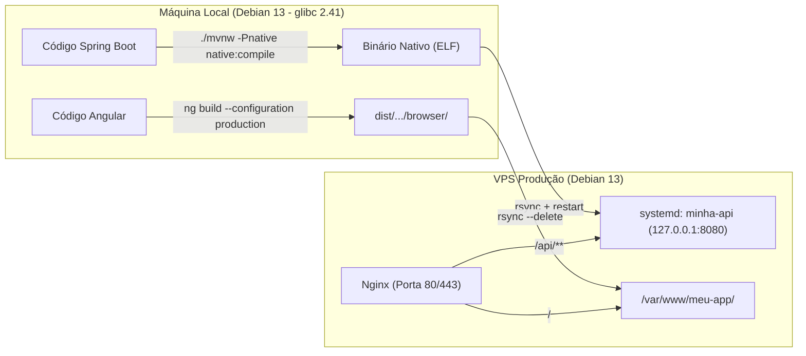
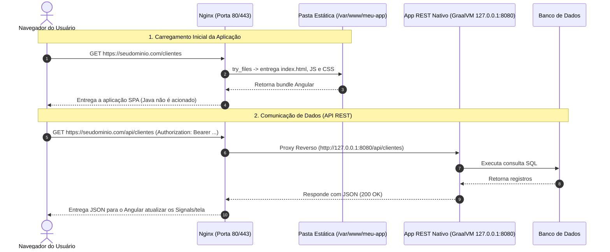

# Guia Prático: Separação entre Back-end Java (Spring Boot) e Front-end Angular

> **Objetivo do estudo:** Orientar a transição de uma aplicação monolítica acoplada (**Spring Boot + Thymeleaf**) para uma arquitetura desacoplada (**API REST Java com compilação nativa GraalVM + SPA Angular em TypeScript**), cobrindo desde as decisões arquiteturais e adaptações de código até o fluxo de build local (Debian 13) e publicação em produção com Nginx e `systemd` em uma VPS.

---

## Sumário

1. [Visão Geral: Do Monólito Acoplado (Thymeleaf) à Arquitetura Desacoplada](#1-visão-geral-do-monólito-acoplado-thymeleaf-à-arquitetura-desacoplada)
2. [Estratégia de Migração no Back-end (Spring Boot)](#2-estratégia-de-migração-no-back-end-spring-boot)
3. [Estratégia de Migração no Front-end (Angular Moderno e TypeScript)](#3-estratégia-de-migração-no-front-end-angular-moderno-e-typescript)
4. [Impacto da Remoção do Thymeleaf na Compilação Nativa (GraalVM)](#4-impacto-da-remoção-do-thymeleaf-na-compilação-nativa-graalvm)
5. [Fluxo de Build Local (Debian 13) e Deploy na VPS](#5-fluxo-de-build-local-debian-13-e-deploy-na-vps)
6. [Configuração de Produção: systemd e Nginx como Proxy Reverso](#6-configuração-de-produção-systemd-e-nginx-como-proxy-reverso)
7. [Arquitetura em Execução: Diagramas de Sequência e Deploy](#7-arquitetura-em-execução-diagramas-de-sequência-e-deploy)
8. [Checklist Final de Migração e Publicação](#8-checklist-final-de-migração-e-publicação)

---

## 1. Visão Geral: Do Monólito Acoplado (Thymeleaf) à Arquitetura Desacoplada

O Thymeleaf é um motor de templates *Server-Side Rendering* (SSR) que executa dentro do servidor Java e devolve páginas HTML já montadas para o navegador. Quando você decide separar o front-end do back-end, ocorre uma mudança estrutural clara: o Spring Boot deixa de gerar telas e passa a operar exclusivamente como uma **API REST (JSON)**, enquanto a interface gráfica torna-se uma **Single Page Application (SPA)** independente executada no navegador do usuário.

### 1.1. O que muda na prática

| Dimensão | Monólito (Spring Boot + Thymeleaf) | Arquitetura Desacoplada (Spring Boot API + Angular) |
| :--- | :--- | :--- |
| **Papel do Spring Boot** | `@Controller` renderiza templates HTML usando `Model`. | `@RestController` expõe endpoints que recebem e retornam JSON (DTOs / Java `record`). |
| **Experiência do Usuário** | Recarregamento completo da página a cada navegação ou envio de formulário. | Navegação instantânea no navegador; apenas os dados necessários trafegam em segundo plano. |
| **Reuso do Back-end** | Acoplado à interface web HTML. | A mesma API atende o site Angular, aplicativos mobile e integrações de terceiros. |
| **Autenticação** | Sessão *stateful* armazenada no servidor + cookies de sessão + proteção CSRF em formulários. | Arquitetura *stateless* com tokens (JWT / OAuth2) no cabeçalho `Authorization` ou cookies `HttpOnly` seguros. |
| **Deploy e Escala** | Um único artefato monolítico; qualquer ajuste visual exige recompilar o Java. | Ciclos independentes: front-end vira arquivos estáticos (Nginx/CDN) e back-end roda isolado. |

### 1.2. Trade-offs e alternativa intermediária

Desacoplar traz vantagens claras de manutenção, escalabilidade e divisão de equipes, mas cobra um preço inicial:

* **Mais infraestrutura e pipeline:** Você passa a manter dois projetos (ou um monorepo com dois builds distintos) e duas rotinas de publicação.
* **Novos desafios de comunicação:** Em ambiente local, portas diferentes (`localhost:4200` no Angular e `localhost:8080` no Spring Boot) exigem configuração de **CORS** ou uso de **proxy de desenvolvimento**. Além disso, controle de estado, validação visual e tratamento de erros HTTP passam a ser responsabilidade do front-end.

> **Alternativa intermediária (quando não vale separar tudo):**
> Se o objetivo for apenas evitar recarregamentos inteiros de página em um sistema pequeno ou mantido por uma única pessoa — sem gerenciar dois builds e APIs REST completas —, combinar **Thymeleaf + HTMX** permite atualizar trechos de HTML via requisições parciais mantendo tudo em um único projeto Java. Contudo, para aplicações corporativas robustas, múltiplas interfaces (web + mobile) e alinhamento com o mercado, a separação entre **Spring Boot + SPA (Angular/React)** continua sendo o padrão consolidado.

### 1.3. Por que escolher Angular vindo do ecossistema Java

| Framework | Perfil e Pontos Fortes | Quando Escolher |
| :--- | :--- | :--- |
| **Angular** | Framework completo e opinativo (rotas, formulários reativos, cliente HTTP, injeção de dependências e *Signals* nativos). | **Transição mais natural para devs Java/Spring**, pois compartilha TypeScript fortemente tipado, injeção de dependências, decorators e organização modular previsível. |
| **React** | Biblioteca focada em interface com ecossistema vasto e alta liberdade de escolha para rotas e estado. | Quando a prioridade é máxima flexibilidade arquitetural ou maior volume de vagas no mercado geral. |
| **Vue.js** | Progressivo, leve e com curva de aprendizado mais suave. | Equipes enxutas que buscam produtividade rápida com menos cerimônia estrutural. |

---

## 2. Estratégia de Migração no Back-end (Spring Boot)

A grande vantagem da migração incremental é que **você não precisa reescrever suas regras de negócio**. Suas camadas `Service`, `Repository`, entidades JPA e banco de dados permanecem intactas. A refatoração concentra-se na borda da aplicação (Controllers, Segurança e Tratamento de Exceções).

### 2.1. Troca de `@Controller` por `@RestController` e uso de Java `record`

Nos controllers antigos com Thymeleaf, os métodos retornavam nomes de views (`"clientes/lista"`) e preenchiam objetos `Model`. Na API REST, eles passam a retornar `ResponseEntity<T>` utilizando **Java `record`** como DTOs — prática altamente recomendada tanto pela imutabilidade quanto pela compatibilidade com o compilador nativo da GraalVM.

```java
// src/main/java/com/exemplo/api/dto/ClienteDTO.java
package com.exemplo.api.dto;

import jakarta.validation.constraints.Email;
import jakarta.validation.constraints.NotBlank;

public record ClienteDTO(
    Long id,
    @NotBlank(message = "O nome é obrigatório") String nome,
    @NotBlank @Email(message = "E-mail inválido") String email
) {}
```

```java
// src/main/java/com/exemplo/api/controller/ClienteController.java
package com.exemplo.api.controller;

import com.exemplo.api.dto.ClienteDTO;
import com.exemplo.api.service.ClienteService;
import jakarta.validation.Valid;
import org.springframework.http.HttpStatus;
import org.springframework.http.ResponseEntity;
import org.springframework.web.bind.annotation.*;

import java.util.List;

@RestController
@RequestMapping("/api/clientes")
public class ClienteController {

    private final ClienteService clienteService;

    public ClienteController(ClienteService clienteService) {
        this.clienteService = clienteService;
    }

    @GetMapping
    public ResponseEntity<List<ClienteDTO>> listar() {
        return ResponseEntity.ok(clienteService.listarTodos());
    }

    @GetMapping("/{id}")
    public ResponseEntity<ClienteDTO> buscarPorId(@PathVariable Long id) {
        return ResponseEntity.ok(clienteService.buscarPorId(id));
    }

    @PostMapping
    public ResponseEntity<ClienteDTO> criar(@Valid @RequestBody ClienteDTO dto) {
        ClienteDTO criado = clienteService.salvar(dto);
        return ResponseEntity.status(HttpStatus.CREATED).body(criado);
    }

    @PutMapping("/{id}")
    public ResponseEntity<ClienteDTO> atualizar(@PathVariable Long id, @Valid @RequestBody ClienteDTO dto) {
        return ResponseEntity.ok(clienteService.atualizar(id, dto));
    }

    @DeleteMapping("/{id}")
    public ResponseEntity<Void> remover(@PathVariable Long id) {
        clienteService.remover(id);
        return ResponseEntity.noContent().build();
    }
}
```

> **Padronização de URLs:** Adote o prefixo `/api/**` em todos os controllers REST. Isso simplifica drasticamente o roteamento do proxy reverso (Nginx) em produção e evita colisões com rotas de tela do Angular (como `/clientes` no navegador vs. `/api/clientes` no back-end).

### 2.2. Tratamento Global de Erros com `ProblemDetail` (RFC 9457)

Com o Thymeleaf, erros de validação voltavam acoplados ao formulário HTML via `BindingResult`. Em uma API REST moderna (Spring Boot 3+ e 4+), utilize `@RestControllerAdvice` retornando `ProblemDetail` para entregar respostas JSON padronizadas que o Angular consome facilmente.

```java
// src/main/java/com/exemplo/api/exception/ApiExceptionHandler.java
package com.exemplo.api.exception;

import org.springframework.http.HttpStatus;
import org.springframework.http.ProblemDetail;
import org.springframework.validation.FieldError;
import org.springframework.web.bind.MethodArgumentNotValidException;
import org.springframework.web.bind.annotation.ExceptionHandler;
import org.springframework.web.bind.annotation.RestControllerAdvice;

import java.util.Map;
import java.util.stream.Collectors;

@RestControllerAdvice
public class ApiExceptionHandler {

    @ExceptionHandler(MethodArgumentNotValidException.class)
    public ProblemDetail handleValidationErrors(MethodArgumentNotValidException ex) {
        ProblemDetail problem = ProblemDetail.forStatusAndDetail(
            HttpStatus.BAD_REQUEST,
            "Erro de validação nos dados enviados."
        );
        problem.setTitle("Dados inválidos");

        Map<String, String> erros = ex.getBindingResult().getFieldErrors().stream()
            .collect(Collectors.toMap(
                FieldError::getField,
                err -> err.getDefaultMessage() != null ? err.getDefaultMessage() : "Inválido",
                (a, b) -> a
            ));

        problem.setProperty("campos", erros);
        return problem;
    }
}
```

### 2.3. Spring Security *Stateless* e Configuração Correta de CORS

Um erro clássico na migração é configurar o CORS apenas em `WebMvcConfigurer` quando o **Spring Security** está ativo. Sem integração explícita no filtro de segurança, requisições `OPTIONS` (*preflight*) do navegador acabam bloqueadas antes mesmo de chegar ao Spring MVC.

Configure a política `STATELESS` e declare um bean `CorsConfigurationSource` integrado ao `SecurityFilterChain`:

```java
// src/main/java/com/exemplo/api/config/SecurityConfig.java
package com.exemplo.api.config;

import org.springframework.context.annotation.Bean;
import org.springframework.context.annotation.Configuration;
import org.springframework.security.config.Customizer;
import org.springframework.security.config.annotation.web.builders.HttpSecurity;
import org.springframework.security.config.annotation.web.configuration.EnableWebSecurity;
import org.springframework.security.config.http.SessionCreationPolicy;
import org.springframework.security.web.SecurityFilterChain;
import org.springframework.web.cors.CorsConfiguration;
import org.springframework.web.cors.CorsConfigurationSource;
import org.springframework.web.cors.UrlBasedCorsConfigurationSource;

import java.util.List;

@Configuration
@EnableWebSecurity
public class SecurityConfig {

    @Bean
    public SecurityFilterChain securityFilterChain(HttpSecurity http) throws Exception {
        return http
            // Desabilitado apenas para APIs stateless baseadas em token no header Authorization
            .csrf(csrf -> csrf.disable())
            // Integra automaticamente com o bean corsConfigurationSource()
            .cors(Customizer.withDefaults())
            .sessionManagement(session ->
                session.sessionCreationPolicy(SessionCreationPolicy.STATELESS)
            )
            .authorizeHttpRequests(auth -> auth
                .requestMatchers("/api/auth/**", "/actuator/health").permitAll()
                .anyRequest().authenticated()
            )
            // Aqui entra seu filtro JWT antes de UsernamePasswordAuthenticationFilter
            // .addFilterBefore(jwtFilter, UsernamePasswordAuthenticationFilter.class)
            .build();
    }

    @Bean
    public CorsConfigurationSource corsConfigurationSource() {
        CorsConfiguration config = new CorsConfiguration();
        config.setAllowedOrigins(List.of("http://localhost:4200")); // Em produção com Nginx na mesma origem, CORS nem será acionado
        config.setAllowedMethods(List.of("GET", "POST", "PUT", "PATCH", "DELETE", "OPTIONS"));
        config.setAllowedHeaders(List.of("Authorization", "Content-Type"));
        config.setAllowCredentials(true);

        UrlBasedCorsConfigurationSource source = new UrlBasedCorsConfigurationSource();
        source.registerCorsConfiguration("/api/**", config);
        return source;
    }
}
```

> **Nota sobre Segurança de Tokens (JWT):** Armazenar JWT em `localStorage` expõe o token a ataques XSS (*Cross-Site Scripting*), enquanto armazená-lo em cookie `HttpOnly` + `Secure` + `SameSite=Lax/Strict` protege contra leitura via JavaScript (exigindo atenção a CSRF). Avalie o nível de risco do seu projeto ao escolher entre `Authorization: Bearer` e cookies `HttpOnly`.

### 2.4. Limpeza de Dependências do Thymeleaf

Quando todas as rotas HTML tiverem sido migradas para o Angular:

1. Remova `spring-boot-starter-thymeleaf` (e extensões como `thymeleaf-extras-springsecurity6`) do seu `pom.xml` ou `build.gradle`.
2. Exclua os templates e assets obsoletos em `src/main/resources/templates/` e `src/main/resources/static/` (caso o Spring Boot não sirva mais arquivos estáticos).

---

## 3. Estratégia de Migração no Front-end (Angular Moderno e TypeScript)

Nas versões modernas do Angular (Angular 18 a 21+), a arquitetura é baseada em **componentes *standalone*** (sem `NgModule`), provedores funcionais (`provideRouter`, `provideHttpClient`), **Signals** para reatividade granular e detecção de mudanças **Zoneless** (estável desde o Angular 20.2 e padrão a partir do Angular 21).

### 3.1. O que passa a ser responsabilidade do Angular

* **Roteamento no navegador (*Client-Side Routing*):** A barra de endereços não envia requisições HTML ao JavaScript do servidor a cada clique; o `Angular Router` intercepta a URL (`/clientes`, `/pedidos/42`) e troca apenas o componente exibido.
* **Busca ativa de dados:** Ao inicializar uma rota ou reagir a uma ação do usuário, serviços Angular fazem chamadas assíncronas para `/api/**` via `HttpClient`.
* **Feedback visual e estado:** Spinners de carregamento, mensagens de validação vindas do `ProblemDetail` e redirecionamento para `/login` quando a API devolve `401 Unauthorized` ficam sob controle do front-end.

### 3.2. Configuração base (`app.config.ts`) e Interceptor Funcional

No Angular moderno, a injeção do `HttpClient` e de interceptors (como envio automático do token JWT) é feita por funções em `src/app/app.config.ts`:

```typescript
// src/app/core/interceptors/auth.interceptor.ts
import { HttpInterceptorFn } from '@angular/common/http';

export const authInterceptor: HttpInterceptorFn = (req, next) => {
  const token = sessionStorage.getItem('access_token');

  if (!token) {
    return next(req);
  }

  const reqAutenticada = req.clone({
    setHeaders: {
      Authorization: `Bearer ${token}`,
    },
  });

  return next(reqAutenticada);
};
```

```typescript
// src/app/app.config.ts
import { ApplicationConfig } from '@angular/core';
import { provideRouter } from '@angular/router';
import { provideHttpClient, withInterceptors } from '@angular/common/http';
import { routes } from './app.routes';
import { authInterceptor } from './core/interceptors/auth.interceptor';

export const appConfig: ApplicationConfig = {
  providers: [
    provideRouter(routes),
    provideHttpClient(withInterceptors([authInterceptor])),
    // Em Angular 21+, o modo zoneless já é o padrão.
    // No Angular 20.2+, use provideZonelessChangeDetection() caso ainda utilize Zone.js por padrão.
  ],
};
```

### 3.3. Serviço de API tipado e uso com `Signals`

```typescript
// src/app/features/clientes/cliente.service.ts
import { inject, Injectable } from '@angular/core';
import { HttpClient } from '@angular/common/http';
import { Observable } from 'rxjs';

export interface Cliente {
  id?: number;
  nome: string;
  email: string;
}

@Injectable({ providedIn: 'root' })
export class ClienteService {
  private readonly http = inject(HttpClient);
  // Caminho relativo! Funciona tanto com proxy.conf.json (dev) quanto com Nginx (prod)
  private readonly apiUrl = '/api/clientes';

  listar(): Observable<Cliente[]> {
    return this.http.get<Cliente[]>(this.apiUrl);
  }

  criar(cliente: Cliente): Observable<Cliente> {
    return this.http.post<Cliente>(this.apiUrl, cliente);
  }
}
```

### 3.4. Desenvolvimento local sem dor de cabeça com CORS (`proxy.conf.json`)

Mesmo tendo configurado o CORS no Spring Boot, usar um arquivo de proxy no Angular CLI permite que o front-end chame `/api/clientes` diretamente (sem `http://localhost:8080` fixo no código TypeScript) — mantendo o código exatamente igual ao que rodará atrás do Nginx em produção:

```json
// proxy.conf.json (na raiz do projeto Angular)
{
  "/api": {
    "target": "http://localhost:8080",
    "secure": false,
    "changeOrigin": true
  }
}
```

Execute localmente com:

```bash
ng serve --proxy-config proxy.conf.json
```

*(Ou adicione `"proxyConfig": "proxy.conf.json"` dentro de `architect.serve.options` no `angular.json` para rodar apenas `ng serve`.)*

---

## 4. Impacto da Remoção do Thymeleaf na Compilação Nativa (GraalVM)

Remover o Thymeleaf traz um ganho expressivo para quem compila a API Java com **GraalVM Native Image**. Motores de templates dinâmicos dependem intensamente de reflexão em tempo de execução, leitura de arquivos no classpath e expressão dinâmica (SpEL/OGNL) — tudo aquilo que exige metadados extras e aumenta o tamanho do binário nativo.

### 4.1. Por que o desacoplamento favorece a GraalVM

* **Análise estática mais limpa:** Sem renderização de templates HTML, o analisador *Ahead-of-Time* (AOT) do Spring e da GraalVM rastreia um grafo de chamadas muito menor e mais previsível, gerando executáveis mais enxutos e builds mais rápidos.
* **Front-end fora do executável:** O código Angular não entra no binário Java. Ele é compilado separadamente para HTML/CSS/JS estáticos e entregue diretamente pelo Nginx ou por uma CDN, sem consumir um único byte de memória heap/nativa da aplicação Java.
* **Partida em milissegundos e baixo consumo de RAM:** Uma API REST pura compilada com GraalVM inicia em dezenas de milissegundos e consome uma fração da memória RAM exigida por uma JVM tradicional — característica ideal para VPS com recursos limitados (1 GB a 4 GB de RAM).

### 4.2. Comandos de build e fluxo recomendado

* **Desenvolvimento diário (JVM tradicional):** A compilação nativa da GraalVM consome bastante RAM (frequentemente 4 GB a 8 GB+ durante o build) e leva alguns minutos. No dia a dia local, rode sempre na JVM comum (`./mvnw spring-boot:run`) com DevTools/Docker Compose e reserve o build nativo para testes de homologação ou deploy.
* **Compilação do executável nativo local (com GraalVM JDK ativo no `JAVA_HOME`):**

```bash
./mvnw -Pnative clean native:compile
```

O binário nativo autossuficiente será gerado em `target/<nome-do-artefato>`.

* **Alternativa via Cloud Native Buildpacks (requer Docker, sem precisar instalar GraalVM localmente):**

```bash
./mvnw -Pnative clean spring-boot:build-image
```

### 4.3. Cuidados práticos na API nativa

1. **Prefira `record` para DTOs:** A serialização JSON do Jackson utiliza reflexão. O mecanismo AOT do Spring Boot registra automaticamente os tipos usados diretamente nos parâmetros e retornos de métodos `@RestController`.
2. **DTOs genéricos ou usados indiretamente:** Caso algum objeto serializado não apareça explicitamente na assinatura do controller (ex.: mapa dinâmico ou wrapper genérico), anote o controller ou classe de configuração com `@RegisterReflectionForBinding({ MeuDto.class })`.
3. **Testes em modo nativo antes do deploy:** Sempre valide o binário gerado localmente (ou com `./mvnw -Pnative test`) para garantir que nenhuma biblioteca de terceiros (drivers, clientes HTTP, relatórios PDF) falhou por falta de *reachability metadata*.

---

## 5. Fluxo de Build Local (Debian 13) e Deploy na VPS

Compilar tanto o binário nativo Java quanto o bundle de produção do Angular na sua máquina local com **Debian 13 (Trixie)** e enviar apenas os artefatos prontos para a VPS é uma excelente estratégia para servidores econômicos: evita picos de CPU/RAM (OOM Killer) na VPS durante o build da GraalVM e do Node.js.

### 5.1. Matriz de compatibilidade: Máquina Local (Debian 13) vs. VPS

Como o executável da GraalVM é um binário nativo ELF (e não bytecode Java portável `.jar`), duas regras são obrigatórias:

1. **Mesma arquitetura de CPU:** Se a VPS for `x86_64` (`amd64`), o build precisa ocorrer em `x86_64`. Se a VPS for `ARM64` (`aarch64`, comum em instâncias econômicas), compile em `ARM64` (ou via emulação/runner compatível). Verifique em ambos os ambientes com:

   ```bash
   uname -m
   ```

2. **Compatibilidade da `glibc`:** Por padrão, o executável da GraalVM vincula-se dinamicamente à biblioteca C do sistema (`glibc`). O **Debian 13 (Trixie)** — lançado em agosto de 2025 — utiliza a **`glibc 2.41`**. Se você compilar no Debian 13 e tentar rodar em uma VPS com sistema mais antigo (como Debian 12 com `glibc 2.36` ou Ubuntu 22.04 com `glibc 2.35`), o binário pode falhar ao iniciar com erros do tipo `version 'GLIBC_2.38' not found`.
   * **Regra de ouro:** Use **Debian 13 (Trixie)** tanto na máquina de build quanto na VPS (ou utilize build via container Docker com a mesma distribuição da VPS). Confira a versão instalada com:

   ```bash
   ldd --version
   ```

### 5.2. Atenção à pasta de saída do Angular (`dist/<projeto>/browser`)

Nas versões atuais do Angular que utilizam o *application builder* (`@angular/build:application`), o comando de build de produção gera os arquivos estáticos dentro da subpasta **`browser/`**:

```bash
ng build --configuration production
```

Estrutura gerada:

```text
dist/
└── meu-app-angular/
    └── browser/          <-- Arquivos que devem ir para o Nginx (index.html, JS, CSS)
```

*(Caso queira remover a subpasta `browser` por preferência de pipeline, basta configurar `"outputPath": { "base": "dist/meu-app-angular", "browser": "" }` no `angular.json`.)*

### 5.3. Passo a passo do Build & Transferência via `rsync`

Assumindo diretórios organizados na VPS (`/opt/api/` para o binário Java e `/var/www/meu-app/` para os arquivos estáticos do Angular):

```bash
# 1. Na pasta do back-end (máquina local Debian 13)
./mvnw -Pnative clean native:compile

# 2. Na pasta do front-end (máquina local Debian 13)
npm ci && npx ng build --configuration production

# 3. Envio do front-end estático (--delete remove arquivos antigos de hashes anteriores)
rsync -avz --delete dist/meu-app-angular/browser/ usuario@ip-da-vps:/var/www/meu-app/

# 4. Envio do binário nativo do back-end (para um nome temporário e troca atômica)
rsync -avz target/minha-api usuario@ip-da-vps:/opt/api/minha-api.new
ssh usuario@ip-da-vps "chmod +x /opt/api/minha-api.new && mv /opt/api/minha-api.new /opt/api/minha-api && sudo systemctl restart minha-api"
```

> **Por que usar troca atômica (`mv`)?** Sobrescrever um binário Linux enquanto ele está em execução pode falhar com `Text file busy`. Copiar para `.new` e mover antes de reiniciar o serviço garante atualização limpa e com tempo mínimo de indisponibilidade.

---

## 6. Configuração de Produção: `systemd` e Nginx como Proxy Reverso

Em produção, o Angular não roda como processo Node.js no servidor — ele vive no navegador do cliente. Na VPS, apenas dois serviços ficam ativos para servir sua aplicação: o **binário nativo Spring Boot** (escutando localmente em `127.0.0.1:8080`) e o **Nginx** (atuando como porta de entrada pública na porta `80`/`443`).

### 6.1. Serviço `systemd` para a API Nativa

Crie o arquivo `/etc/systemd/system/minha-api.service` na VPS (evitando rodar a API como `root` e isolando variáveis sensíveis em um arquivo de ambiente):

```ini
[Unit]
Description=API REST Spring Boot Nativa (GraalVM)
After=network.target postgresql.service

[Service]
Type=simple
User=www-data
Group=www-data
WorkingDirectory=/opt/api
EnvironmentFile=/etc/minha-api/env
ExecStart=/opt/api/minha-api --spring.profiles.active=prod
Restart=always
RestartSec=3

# Endurecimento básico de segurança
NoNewPrivileges=true
PrivateTmp=true

[Install]
WantedBy=multi-user.target
```

No arquivo `/etc/minha-api/env` (com permissão `chmod 600` pertencente a `root` ou `www-data` conforme leitura):

```env
SERVER_ADDRESS=127.0.0.1
SERVER_PORT=8080
SPRING_DATASOURCE_URL=jdbc:postgresql://localhost:5432/meubanco
SPRING_DATASOURCE_USERNAME=app_user
SPRING_DATASOURCE_PASSWORD=sua_senha_segura
JWT_SECRET=sua_chave_secreta_longa
```

Ative e acompanhe os logs com:

```bash
sudo systemctl daemon-reload
sudo systemctl enable --now minha-api
sudo journalctl -u minha-api -f
```

> **Dica de segurança:** Configurar `SERVER_ADDRESS=127.0.0.1` garante que a porta `8080` fique acessível **apenas** pelo Nginx na própria VPS, impedindo acesso direto externo que contornaria o TLS/HTTPS e os limites do proxy.

### 6.2. Nginx: Entrega da SPA Angular + Proxy Reverso para `/api/`

Crie o bloco de servidor em `/etc/nginx/sites-available/meu-app.conf`:

```nginx
server {
    listen 80;
    server_name seudominio.com www.seudominio.com;

    # Compressão Gzip para acelerar o carregamento do bundle Angular
    gzip on;
    gzip_types text/plain text/css application/json application/javascript text/xml application/xml text/javascript;

    root /var/www/meu-app;
    index index.html;

    # 1. Cache longo para arquivos com hash gerado pelo ng build (main-XXXX.js, styles-XXXX.css)
    location ~* \.(?:js|css|woff2?|svg|png|jpg|jpeg|gif|ico)$ {
        expires 1y;
        add_header Cache-Control "public, immutable";
        try_files $uri =404;
    }

    # 2. Nunca fazer cache agressivo do index.html (garante que o usuário receba novos deploys)
    location = /index.html {
        add_header Cache-Control "no-cache, no-store, must-revalidate";
    }

    # 3. Chamadas de API seguem internamente para o binário GraalVM
    location /api/ {
        proxy_pass http://127.0.0.1:8080;
        proxy_http_version 1.1;
        proxy_set_header Host $host;
        proxy_set_header X-Real-IP $remote_addr;
        proxy_set_header X-Forwarded-For $proxy_add_x_forwarded_for;
        proxy_set_header X-Forwarded-Proto $scheme;
    }

    # 4. Fallback obrigatório para rotas da SPA Angular (evita 404 ao dar F5 em /clientes/10)
    location / {
        try_files $uri $uri/ /index.html;
    }
}
```

Ative o site e aplique HTTPS gratuito via Let's Encrypt (`certbot`):

```bash
sudo ln -s /etc/nginx/sites-available/meu-app.conf /etc/nginx/sites-enabled/
sudo nginx -t && sudo systemctl reload nginx
sudo certbot --nginx -d seudominio.com -d www.seudominio.com
```

### 6.3. O benefício oculto dessa topologia: Adeus, CORS em produção

Como o Nginx serve tanto os arquivos estáticos do Angular (`/`) quanto a API Java (`/api/**`) sob o **mesmo domínio e mesma porta** (`https://seudominio.com:443`), o navegador reconhece todas as requisições como **Mesma Origem (*Same-Origin*)**. Resultado: zero bloqueios de CORS em produção e zero requisições extras de *preflight* (`OPTIONS`), reduzindo a latência percebida pelo usuário.

---

## 7. Arquitetura em Execução: Diagramas de Sequência e Deploy

### 7.1. Fluxo de Build e Publicação (Debian 13 -> VPS)



### 7.2. Fluxo de Requisições em Tempo de Execução



**Leitura rápida do fluxo:**

* **Etapas 1 a 4:** O Nginx lê os arquivos estáticos diretamente do disco (com cache e compressão). O executável nativo Java nem sequer é acionado, poupando CPU e conexões de banco.
* **Etapas 5 a 10:** Já executando no navegador, o Angular solicita dados JSON para `/api/clientes`. O Nginx intercepta o prefixo `/api/`, encaminha via rede local (`127.0.0.1:8080`) para o binário GraalVM e devolve o JSON ao navegador sem disparar CORS.

---

## 8. Checklist Final de Migração e Publicação

* [ ] **Back-end REST:** Controllers convertidos de `@Controller` para `@RestController` sob prefixo `/api/**`, retornando Java `record` e `ResponseEntity`.
* [ ] **Erros padronizados:** `@RestControllerAdvice` configurado com `ProblemDetail` para validações (`400 Bad Request`) e exceções de negócio.
* [ ] **Segurança e CORS:** `SecurityFilterChain` configurado como `STATELESS`, com `CorsConfigurationSource` apenas para desenvolvimento (`localhost:4200`) e filtro JWT validado.
* [ ] **Limpeza:** Dependência `spring-boot-starter-thymeleaf` e pasta `src/main/resources/templates` removidas.
* [ ] **Front-end Angular:** `provideRouter` + `provideHttpClient(withInterceptors([...]))` configurados; `proxy.conf.json` ativo para uso local com caminhos relativos `/api/...`.
* [ ] **Compatibilidade Binária:** Mesma arquitetura (`uname -m`) e versão compatível de `glibc` (`ldd --version`) validadas entre o Debian 13 local e a VPS.
* [ ] **Teste Nativo:** Binário gerado com `./mvnw -Pnative clean native:compile` testado antes do envio.
* [ ] **Produção VPS:** Binário gerenciado pelo `systemd` em `127.0.0.1:8080`, Nginx servindo `dist/<projeto>/browser/` com `try_files ... /index.html`, proxy em `/api/` e HTTPS ativo via Certbot.
